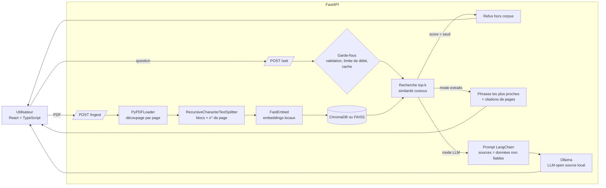

# AI Knowledge Agent: local RAG over your PDFs

[Français](#français) · [English](#english)


<!-- Demo: put docs/media/demo.gif here (see "Scénario de démo") -->
<!--  -->

---

## Français

### Le problème

Les documents internes (règlements, manuels, procédures) sont longs, et l'information
utile est difficile à retrouver. Ce projet permet de **poser des questions en langage
naturel sur des PDF** et d'obtenir une réponse **avec les pages sources citées**, ou un
refus explicite quand le document ne contient pas la réponse.

Tout tourne **en local, avec des outils open source et gratuits** : aucune clé d'API payante,
aucune donnée envoyée à un service externe.

### Ce que fait le projet

- **Ingestion de PDF** : extraction page par page, découpage en blocs qui gardent leur numéro
  de page, ré-ingestion idempotente (le même fichier n'est pas indexé deux fois).
- **Recherche sémantique** : embeddings locaux multilingues (FastEmbed, ONNX sur CPU),
  base vectorielle **ChromaDB** (par défaut) ou **FAISS**.
- **Réponse avec citations** :
  - mode **extraits** (par défaut, sans LLM) : les phrases les plus pertinentes, avec `[p. N]` ;
  - mode **LLM local** via **Ollama** (ex. `qwen2.5:3b`), orchestré avec **LangChain**.
- **Refus hors corpus** : si aucun passage n'est assez proche de la question, l'API répond
  « Je ne trouve pas cette information dans les documents indexés ».
- **API FastAPI documentée** (`/docs`) : `/ingest`, `/ask`, `/health`, avec latence, tokens et coût par question.
- **Évaluation chiffrée** de la recherche (hit rate, MRR) et comparaison ChromaDB vs FAISS.

### Architecture



### Stack

| Rôle | Outil (tout est open source et gratuit) |
|---|---|
| API | FastAPI, Pydantic v2, Uvicorn |
| Orchestration RAG | LangChain (loaders, text splitter, vector stores, prompt + chat model LCEL) |
| Embeddings | FastEmbed, `paraphrase-multilingual-MiniLM-L12-v2` (CPU, local) |
| Base vectorielle | ChromaDB (par défaut), FAISS (option) |
| LLM (optionnel) | Ollama + modèle open source (`qwen2.5:3b` par défaut) |
| Frontend | React 19, TypeScript, Vite, Tailwind CSS |
| Qualité | pytest (22 tests hors ligne), ruff, oxlint, GitHub Actions |

### Installation et lancement (3 commandes)

Prérequis : Python 3.10+, Node.js 20+.

```bash
# 1. Backend (crée l'environnement, installe les dépendances)
cd backend && python -m venv .venv && .venv/Scripts/pip install -r requirements.txt   # Linux/macOS : .venv/bin/pip

# 2. Lancer l'API (http://localhost:8000/docs)
.venv/Scripts/uvicorn app.main:app --port 8000

# 3. Dans un autre terminal, depuis la racine du dépôt : le frontend (http://localhost:5173)
cd frontend && npm install && npm run dev
```

Au premier lancement, le modèle d'embeddings (~220 Mo) est téléchargé une seule fois
depuis Hugging Face, puis tout fonctionne hors ligne. La configuration se fait dans
`backend/.env` (copier `backend/.env.example`). Le fichier `.env` n'est jamais commité.

**Option LLM local (gratuit)** : installer [Ollama](https://ollama.com), puis :

```bash
ollama pull qwen2.5:3b
```

et mettre `LLM_PROVIDER=ollama` dans `backend/.env`. Un modèle de 3B paramètres tourne sur un
PC portable avec 8 Go de RAM (plus lent sans GPU récent).

### Utilisation

Interface web : cliquer sur **« Utiliser le PDF d'exemple »**, puis poser une question.

API :

```bash
curl -X POST http://localhost:8000/ingest/sample
curl -X POST http://localhost:8000/ingest -F "file=@mon_document.pdf"
curl -X POST http://localhost:8000/ask -H "Content-Type: application/json" \
     -d '{"question": "What is the meal expense limit?"}'
```

> Sous Windows (Git Bash), `curl` n'envoie pas toujours les accents en UTF-8 : utilisez
> plutôt `python scripts/demo_questions.py`, qui indexe le PDF d'exemple et pose 6 questions.

Réponse réelle de `/ask` à la question anglaise ci-dessus (mode extraits ; le modèle
multilingue retrouve le passage français) :

```json
{
  "answer": "Mode extraits (sans LLM) : phrases les plus pertinentes du document.\n- Le plafond de remboursement d'un repas d'affaires est de 60 000 Ariary par personne. [p. 6]",
  "sources": [{"n": 1, "source": "guide-employe-ravinala.pdf", "page": 6, "score": 0.6285, "excerpt": "5. Notes de frais ..."}],
  "refused": false,
  "provider": "none",
  "model": "extractive",
  "latency_ms": {"retrieval": 41.94, "generation": 294.9, "total": 336.84},
  "tokens": {"input": 0, "output": 0, "total": 0},
  "cost_usd": 0.0,
  "cached": false,
  "warnings": []
}
```

En mode extraits, `generation` mesure la sélection des phrases (embeddings), pas un LLM.

| Endpoint | Rôle |
|---|---|
| `GET /health` | état, fournisseur, base vectorielle, nombre de blocs, statistiques du cache |
| `POST /ingest` | upload d'un PDF (multipart) et indexation |
| `POST /ingest/sample` | indexe le PDF d'exemple fourni |
| `POST /upload-stream` | comme `/ingest`, avec progression en Server-Sent Events (utilisé par l'UI) |
| `POST /ask` | réponse, sources (fichier, page, score), refus, latence, tokens, coût |

### Performance, coûts et sécurité

| Sujet | Ce qui est fait |
|---|---|
| Coût | 0 € par question : embeddings et LLM locaux, aucune API payante |
| Cache | cache LRU + TTL des réponses, clé normalisée, invalidé à chaque ingestion |
| Observabilité | journal JSON par requête (`storage/requests.jsonl`) : latence recherche / génération, tokens, cache, refus |
| Confidentialité | le journal ne contient pas le texte des questions, seulement leur longueur et un hash |
| Limite de débit | fenêtre glissante par IP (20 `/ask` et 5 ingestions par minute, configurables) |
| Upload | extension `.pdf`, signature `%PDF-`, taille max (20 Mo), nom de fichier assaini (pas de path traversal) |
| Injection de prompt | les passages sont encadrés comme **données non fiables**, les balises internes sont neutralisées, les consignes suspectes sont signalées (`warnings`) |
| Hors corpus | seuil de similarité cosinus (`MIN_RELEVANCE`) ; en mode LLM, le modèle doit répondre `NOT_IN_CORPUS` |
| Erreurs | codes HTTP explicites : 409 (rien d'indexé), 413, 415, 422, 429, 503 (Ollama arrêté) |

### Résultats de l'évaluation

Jeu d'évaluation : `backend/eval/questions.json`, construit sur le PDF d'exemple
`backend/samples/guide-employe-ravinala.pdf` (10 pages, entreprise **fictive**, texte rédigé
pour ce projet et publié sous **CC0**). Il contient 16 questions **reformulées** (15 en français,
1 en anglais) avec la page attendue, et 4 questions hors sujet.

Commande : `cd backend && python -m eval.evaluate`. Résultats de la recherche (k = 4, mesure au niveau de la page) :

| Configuration | Blocs | Hit@1 | Hit@4 | MRR | Refus hors corpus | Faux refus | Recherche moy. / p95 |
|---|---|---|---|---|---|---|---|
| **ChromaDB, multilingue, blocs 300 (défaut)** | 27 | **0,81** | 0,94 | **0,86** | **100 %** | **0 %** | 18 / 21 ms |
| FAISS, multilingue, blocs 300 | 27 | 0,81 | 0,94 | 0,86 | 100 % | 0 % | 19 / 24 ms |
| ChromaDB, multilingue, blocs 500 | 18 | 0,62 | 0,94 | 0,76 | 75 % | 6 % | 19 / 22 ms |
| ChromaDB, multilingue, blocs 800 | 10 | 0,62 | 1,00 | 0,79 | 75 % | 6 % | 23 / 27 ms |
| FAISS, multilingue, blocs 800 | 10 | 0,62 | 1,00 | 0,79 | 75 % | 6 % | 16 / 18 ms |
| ChromaDB, `bge-small-en`, blocs 800 (1re version) | 10 | 0,44 | 0,81 | 0,57 | 0 % | 0 % | 22 / 27 ms |

Résultats complets : [`backend/eval/results/`](backend/eval/results/). Mesures faites sur un PC
portable (CPU, 8 Go de RAM).

Ce qu'on en retient :

- **Le modèle d'embeddings compte plus que la base vectorielle** : passer de `bge-small-en`
  (modèle anglais de la première version) à un modèle multilingue fait monter le MRR de 0,57 à 0,79.
- **ChromaDB et FAISS donnent exactement la même qualité** : à cette échelle, les deux font une
  recherche quasi exacte. La latence (~15 à 25 ms) est dominée par le calcul de l'embedding de
  la question. FAISS devient intéressant pour de gros volumes en mémoire ; ChromaDB apporte la
  persistance et les métadonnées sans code supplémentaire.
- **Des blocs plus petits (300 caractères) améliorent le classement** (Hit@1 de 0,62 à 0,81) et
  séparent mieux les questions hors sujet. Ce réglage est donc celui par défaut.

Le mode extraits a aussi été vérifié de bout en bout sur 5 questions et 1 question hors sujet
([`demo_extractive.txt`](backend/eval/results/demo_extractive.txt)).

### Limites

- **Petit jeu d'évaluation** (20 questions, un seul document). Le seuil `MIN_RELEVANCE = 0,38`
  a été choisi sur ce même jeu, sans jeu de validation séparé : les chiffres sont indicatifs.
- **La qualité des réponses générées par le LLM n'est pas évaluée** (seule la recherche l'est).
  Le mode Ollama est implémenté et couvert par des tests avec un LLM simulé, mais il n'a pas été
  mesuré sur cette machine.
- Pas d'OCR : les PDF scannés (images) ne sont pas lisibles.
- Une seule collection partagée, pas de comptes utilisateurs ; la limite de débit et le cache sont
  en mémoire (un seul processus).
- Le seuil de refus dépend du modèle d'embeddings : il faut le recalibrer si on en change
  (voir la ligne `bge-small-en`, où aucune question hors sujet n'est refusée avec 0,38).
- Les extraits sont tronqués à 400 caractères dans la réponse de l'API.

### Tests et qualité

```bash
cd backend
pip install -r requirements-dev.txt
pytest -q          # 22 tests, hors ligne : embeddings et LLM simulés
ruff check . && ruff format --check .
cd ../frontend && npm run lint && npm run build
```

La CI GitHub Actions (`.github/workflows/ci.yml`) lance ces mêmes vérifications à chaque push.

### Scénario de démo (20 secondes)

1. (0-4 s) Ouvrir l'interface, cliquer sur **« Utiliser le PDF d'exemple »** : « 10 pages, 27 blocs indexés ».
2. (4-11 s) Cliquer sur **« Quel est le plafond de remboursement d'un repas d'affaires ? »** :
   la réponse cite **[p. 6]**. Déplier « Sources » pour montrer pages et scores, ainsi que la latence et le « coût 0 $ ».
3. (11-16 s) Taper **« Quelle est la capitale du Japon ? »** : encadré orange **« Hors du corpus »**.
4. (16-20 s) Montrer `http://localhost:8000/docs` (Swagger) avec `/ingest`, `/ask`, `/health`.

Fichiers à déposer dans [`docs/media/`](docs/media/) : `demo.gif` (ou `.mp4`),
`screenshot-answer.png`, `screenshot-refusal.png`, `swagger.png`.

### Structure

```
backend/
  app/            config, API FastAPI, schémas, sécurité, cache
  app/rag/        loader, vectorstore (Chroma/FAISS), llm (Ollama), prompts, pipeline
  eval/           questions.json, evaluate.py, results/
  samples/        PDF d'exemple CC0
  scripts/        génération du PDF d'exemple, script de démo
  tests/          pytest (hors ligne)
frontend/         React + TypeScript + Vite + Tailwind
docs/media/       captures et vidéo
```

---

## English

### Problem

Internal documents (policies, manuals, procedures) are long and hard to search. This project
lets you **ask natural-language questions about PDFs** and get an answer **with the cited
source pages**, or an explicit refusal when the documents do not contain the answer.
Everything runs **locally with free, open-source tools**: no paid API key, no data sent to a
third party.

### Features

- PDF ingestion with page-aware chunks; idempotent re-ingestion.
- Local multilingual embeddings (FastEmbed) with **ChromaDB** (default) or **FAISS**.
- Answers with `[p. N]` citations:
  - **extractive mode** (default, no LLM): the most relevant sentences;
  - **local LLM** through **Ollama**, orchestrated with **LangChain** (LCEL prompt → chat model).
- Out-of-corpus refusal (cosine similarity threshold + `NOT_IN_CORPUS` sentinel for the LLM).
- Documented **FastAPI** (`/docs`): `/ingest`, `/ingest/sample`, `/upload-stream`, `/ask`, `/health`.
  `/ask` returns the answer, sources (file, page, score), latency, tokens and cost (always 0, local).
- Safety and cost controls:
  - answer cache (LRU + TTL) and per-IP rate limiting;
  - PDF checks: extension, magic bytes, max size, sanitised filename;
  - prompt-injection hardening: retrieved text is treated as untrusted data, tags are
    neutralised and suspicious instructions are flagged;
  - JSON request log without the question text.
- Retrieval evaluation (hit rate, MRR) and a ChromaDB vs FAISS comparison.

### Quick start (3 commands)

```bash
cd backend && python -m venv .venv && .venv/Scripts/pip install -r requirements.txt   # Linux/macOS: .venv/bin/pip
.venv/Scripts/uvicorn app.main:app --port 8000        # API + Swagger on http://localhost:8000/docs
cd frontend && npm install && npm run dev             # UI on http://localhost:5173 (second terminal)
```

Optional local LLM: install [Ollama](https://ollama.com), run `ollama pull qwen2.5:3b`, and set
`LLM_PROVIDER=ollama` in `backend/.env` (see `backend/.env.example`).

### Evaluation results

The evaluation uses 16 paraphrased questions with their expected page, plus 4 out-of-corpus
questions, over the bundled 10-page CC0 sample PDF (a fictional employee handbook). Run it with
`python -m eval.evaluate` from `backend/`; k = 4.

| Configuration | Hit@1 | Hit@4 | MRR | Out-of-corpus refused | False refusals |
|---|---|---|---|---|---|
| **ChromaDB, multilingual, chunk 300 (default)** | **0.81** | 0.94 | **0.86** | **100 %** | **0 %** |
| FAISS, multilingual, chunk 300 | 0.81 | 0.94 | 0.86 | 100 % | 0 % |
| ChromaDB, multilingual, chunk 800 | 0.62 | 1.00 | 0.79 | 75 % | 6 % |
| ChromaDB, `bge-small-en`, chunk 800 (first version) | 0.44 | 0.81 | 0.57 | 0 % | 0 % |

Key findings:

- The embedding model matters more than the vector store.
- ChromaDB and FAISS give identical quality at this scale.
- Retrieval takes about 15 to 25 ms on a laptop CPU, dominated by embedding the question.
- Smaller chunks rank the right page first more often.

### Limitations

- The evaluation set is small and the refusal threshold was tuned on it, without a held-out set.
- The quality of LLM-generated answers is not evaluated. The Ollama path is unit-tested with a
  fake model but was not benchmarked here.
- There is no OCR, so scanned PDFs are not supported.
- The rate limiter and cache are in-memory, so they work for a single process only.

### License

MIT. See [LICENSE](LICENSE). The sample PDF and its generator text are CC0.
